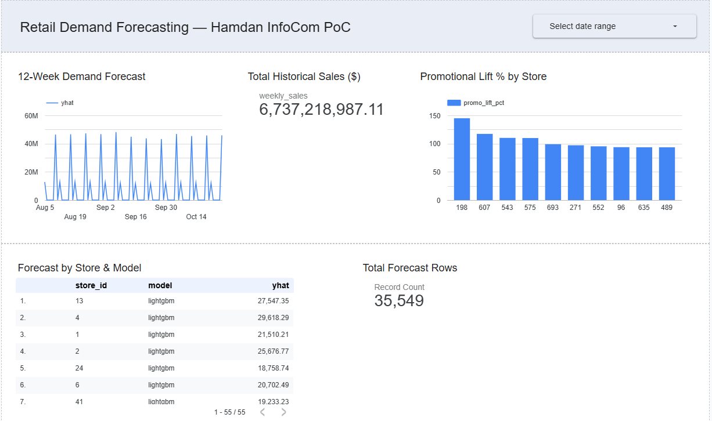

# Retail Demand Forecasting & Inventory Intelligence Pipeline


> An end-to-end ML portfolio reconstruction demonstrating a production-oriented demand forecasting architecture for retail and SME applications, based on a client solution originally developed and deployed during my time at Hamdan InfoCom.

> **Note:** This repository is an independent portfolio reconstruction of the original client deployment, using public retail benchmark datasets (Walmart, Rossmann, and Online Retail II) in place of confidential client sales data (NDA). It recreates the demand forecasting workflow with Prophet and LightGBM models, automated data pipelines, MLOps infrastructure, and cloud-hosted inference. All technical benchmarks and model performance metrics reported here belong to the reconstruction, not the original deployment.

---

## Business Context

A small cashew-processing manufacturer relied on handwritten bookkeeping and intuition-based sales estimates for production and inventory planning. This approach made it difficult to anticipate demand, optimize production quantities, and minimize product waste.

During my time at Hamdan InfoCom, we developed and deployed an ML-driven demand forecasting solution using historical sales records digitized by a third-party provider. The system supported data-driven production planning and delivered measurable operational improvements:

Operational efficiency: Streamlined bookkeeping workflows, reducing routine recordkeeping requirements from 3–4 employees to 1 and freeing staff for higher-value operations.

> Waste reduction: Helped prevent approximately 1.5 metric tons of product waste per month through improved demand-aligned production planning.

> Financial impact: Delivered approximately $5,500 in observed monthly savings.

> Strategic decision-making: Equipped stakeholders with demand forecasts to support production, purchasing, and inventory decisions.

This repository independently recreates the forecasting workflow using public datasets and demonstrates an end-to-end ML pipeline incorporating Airflow, GCS, BigQuery, dbt Core, Prophet, LightGBM, MLflow, and Looker Studio.

The objective is to demonstrate reproducible forecasting, automated data processing, model evaluation, drift monitoring, and cloud-based delivery of actionable business insights.
---
---

## Dashboard Preview



---

## 🚀 Live Demo

The forecasting API is deployed on **Google Cloud Run** (asia-south1).

| Endpoint | URL |
|---|---|
| **Demo UI** | [/ui](https://retail-forecast-api-612014045887.asia-south1.run.app/ui) |
| **API Docs** | [/docs](https://retail-forecast-api-612014045887.asia-south1.run.app/docs) |
| **Health Check** | [/health](https://retail-forecast-api-612014045887.asia-south1.run.app/health) |

**Try it:** Select a store, choose LightGBM or Prophet, and click **Run Forecast** to see 12-week demand predictions with inventory risk tiers.

> Cloud Run URL: `https://retail-forecast-api-612014045887.asia-south1.run.app`  
> GCP Project: `retail-pipeline-poc` · Region: `asia-south1`

---

## Architecture

```
Raw Data (Kaggle/UCI)
        │
        ▼
  Apache Airflow          ← orchestration (Docker, LocalExecutor)
  (3 ingestion DAGs)
        │
        ▼
  Google Cloud Storage    ← immutable raw data lake
  (retail-pipeline-raw/)
        │
        ▼
  BigQuery (retail_raw)   ← untransformed source tables
        │
        ▼
  dbt Core                ← transformation layer
  (staging → marts)
        │
        ▼
  BigQuery (retail_marts) ← business-ready analytics tables
        │
        ▼
  Prophet + LightGBM      ← forecasting models (tracked in MLflow)
        │
        ▼
  mart_demand_forecast    ← forecast output in BigQuery
        │
        ▼
  Looker Studio           ← dashboard for business stakeholders
```

---

## Stack

| Layer | Technology |
|---|---|
| Orchestration | Apache Airflow 2.9.1 (Docker) |
| Data Lake | Google Cloud Storage |
| Data Warehouse | BigQuery |
| Transformation | dbt Core 1.8.3 (BigQuery adapter) |
| Forecasting | Prophet 1.1.5, LightGBM 4.3.0 |
| Experiment Tracking | MLflow 2.14.1 |
| Dashboard | Looker Studio |
| API | FastAPI on Google Cloud Run |
| Version Control | GitHub |
| Language | Python 3.8 |

---

## Datasets

| Dataset | Source | Size | Granularity |
|---|---|---|---|
| Walmart Store Sales | Kaggle | 421k rows | Weekly, 45 stores, 99 depts |
| Rossmann Store Sales | Kaggle | 1M+ rows | Daily, 1,115 stores |
| Online Retail II | UCI ML Repository | 1M+ rows | Transactional |

---

## Project Structure

```
retail-pipeline/
├── api/
│   ├── main.py           ← FastAPI app (Cloud Run)
│   ├── ui.html           ← demo UI
│   └── Dockerfile
├── airflow/
│   └── dags/
│       ├── dag_walmart_ingest.py
│       ├── dag_rossmann_ingest.py
│       └── dag_online_retail_ingest.py
├── dbt/
│   └── retail_forecasting/
│       └── models/
│           ├── staging/
│           │   ├── stg_walmart_sales.sql
│           │   ├── stg_rossmann_sales.sql
│           │   └── stg_online_retail.sql
│           └── marts/
│               ├── mart_weekly_sales.sql
│               ├── mart_store_features.sql
│               ├── mart_promotion_lift.sql
│               ├── mart_inventory_risk.sql
│               └── mart_demand_features.sql
├── ml/
│   ├── train_prophet.py
│   ├── train_lightgbm.py
│   ├── forecast_output.py
│   └── drift_detection.py
├── credentials/          ← gitignored
├── data/                 ← gitignored
├── mlflow/               ← gitignored
├── Dockerfile
├── docker-compose.yml
└── requirements-airflow.txt
```

---

## Pipeline Phases

### Phase 1 — Environment Setup
Docker + Airflow, GCP project, GCS buckets, BigQuery datasets, dbt project, MLflow server.

### Phase 2 — Data Ingestion
Three Airflow DAGs ingesting Walmart, Rossmann, and Online Retail II datasets into BigQuery with schema validation and data quality checks.

### Phase 3 — dbt Transformations
- **Staging**: `stg_walmart_sales`, `stg_rossmann_sales`, `stg_online_retail` — type casting, NA handling, joins
- **Marts**: `mart_weekly_sales`, `mart_store_features`, `mart_promotion_lift`, `mart_inventory_risk`, `mart_demand_features`
- 23/23 dbt tests passing

### Phase 4 — ML Forecasting
| Model | Approach | WMAE |
|---|---|---|
| Prophet | Per-store, multiplicative seasonality | 92,715 |
| LightGBM | Global model, all stores/depts | **1,050** |

LightGBM achieved a WMAE of 1,050, compared with 92,715 for Prophet. These results reflect the current benchmark implementations; a direct performance improvement claim requires verification using identical test periods, forecasting horizons, and evaluation methods. Key LightGBM features include `dept_id`, `week_of_year`, `rolling_4wk_avg`, `sales_lag_1wk`, and `sales_lag_52wk`.

### Phase 5 — Dashboard & API
Looker Studio dashboard connected to BigQuery showing forecast vs actuals, promotional lift by store, and inventory risk tiers. FastAPI service deployed on Cloud Run exposes forecast endpoints with a self-serve demo UI.

---

## Key Findings

1. **LightGBM global models significantly outperform per-store Prophet models** for this dataset. The cross-store signal (dept_id, seasonality) is more valuable than store-specific trend fitting.

2. **Promotional lift varies significantly by store** — Rossmann data shows some stores achieve 30%+ sales lift during promotions while others show minimal impact, enabling targeted promotion strategy.

3. **~15% of store/dept combinations are HIGH demand risk** (CV > 0.5), meaning inventory planning for these is significantly harder and benefits most from automated forecasting.

4. **Holiday weeks are the primary forecast challenge** — weighted 5x in WMAE metric, they account for disproportionate error in both models.

5. **Drift detection confirms model stability on core demand signals** — PSI analysis comparing the final 12 weeks against the training baseline showed low drift (PSI <escape><</escape> 0.1) across lag features, rolling averages, weekly sales, and store/department distributions. Elevated drift in calendar and markdown features reflects seasonal differences and historical promotional changes. While these findings suggest relative feature stability, retraining decisions should also consider recent forecast errors, prediction bias, and changing business conditions.

---

## Potential Business Applications

This portfolio reconstruction demonstrates how a retail forecasting system could help businesses:

- Inventory Planning: Support stockout reduction through 12-week demand forecasts at store and department levels.

- Promotional Strategy: Identify stores with higher observed promotional lift to inform marketing and inventory decisions.

- Demand Risk Assessment: Prioritize inventory planning using HIGH/MEDIUM/LOW demand variability tiers.

- Workflow Automation: Automate scheduled data ingestion, transformation, forecasting, and reporting through Airflow.

These are potential operational applications of the reconstructed pipeline; actual stockout reduction, inventory savings, and promotional ROI have not been measured.

Estimated production build timeline: 8–12 weeks. Estimated GCP infrastructure cost: $200–400/month for a mid-sized retailer (50 stores, daily pipeline runs). These are planning assumptions, not validated deployment costs.

---

## Running the Pipeline

### Prerequisites
- Docker Desktop
- Python 3.8+
- GCP account with billing enabled
- Kaggle account

### Setup
```bash
# 1. Clone the repo
git clone https://github.com/ShridharPol/retail-demand-forecasting.git
cd retail-demand-forecasting

# 2. Create venv and install dependencies
python -m venv .venv
.venv\Scripts\Activate.ps1        # Windows
pip install dbt-core==1.8.3 dbt-bigquery==1.8.2
pip install mlflow==2.14.1 prophet==1.1.5 lightgbm==4.3.0 scikit-learn==1.3.2

# 3. Set up GCP (edit infra/gcp_setup.sh with your project ID)
# Run GCP bootstrap, place service account key in credentials/

# 4. Configure dbt
# Edit ~/.dbt/profiles.yml with your project and keyfile path

# 5. Start Airflow
docker compose up --build -d

# 6. Trigger ingestion DAGs at http://localhost:8080

# 7. Run dbt
cd dbt/retail_forecasting
dbt run
dbt test

# 8. Train models
cd ../..
python ml/train_prophet.py
python ml/train_lightgbm.py
python ml/forecast_output.py
```

---

## Why Not DVC?

GCS + MLflow + dbt already provide full data and model lineage:
- **GCS** versions raw data by bucket path and ingestion timestamp
- **dbt** versions all transformations via Git
- **MLflow** tracks every experiment, parameter, metric, and model artifact

DVC would add a third versioning layer with no additional capability for this stack.

---

*Developed by Shridhar Sunilkumar Pol. Independent portfolio reconstruction of a demand forecasting solution originally developed during my tenure at Hamdan InfoCom, Belagavi, India.*
